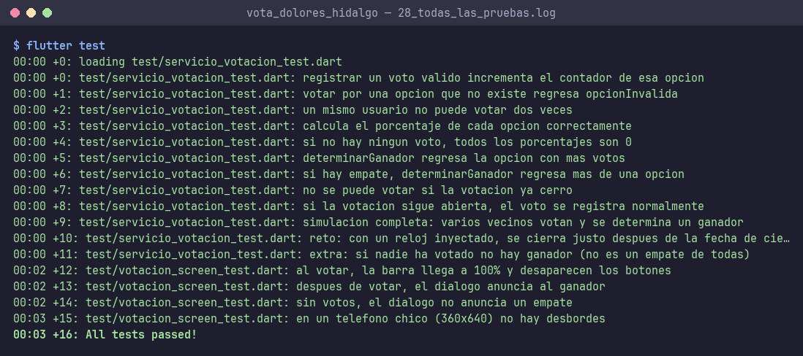
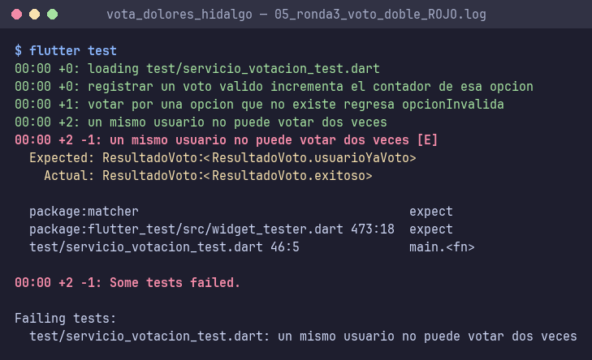
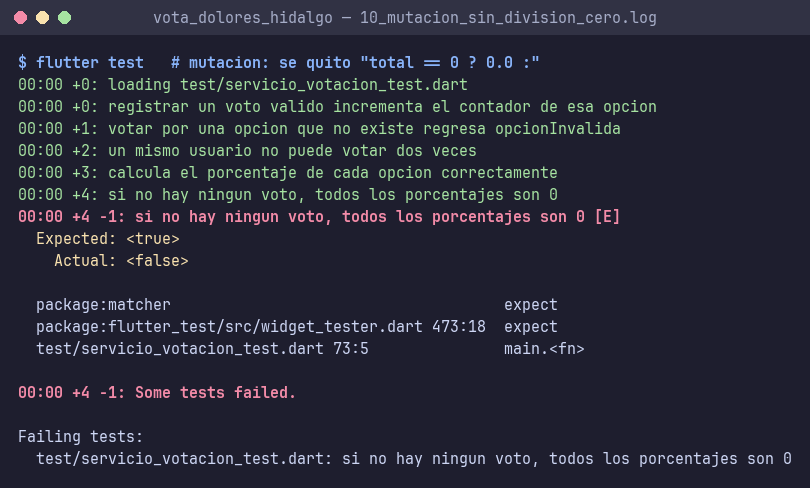
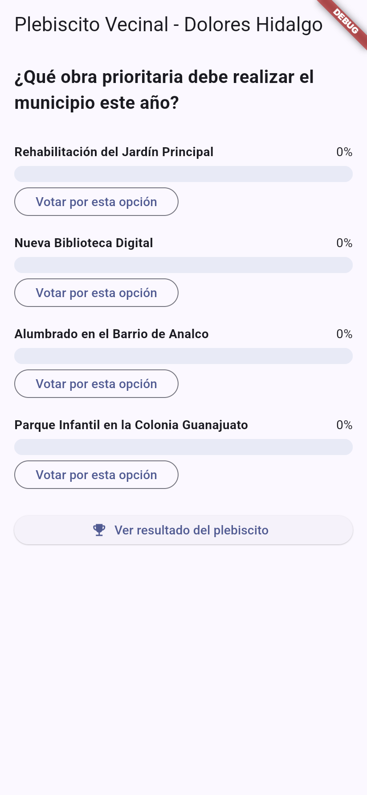
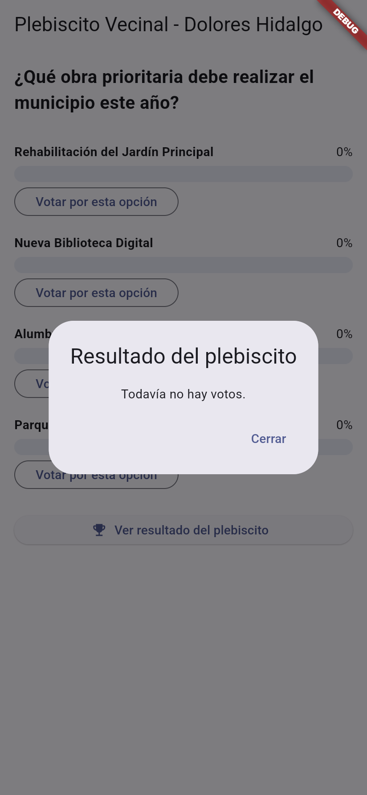
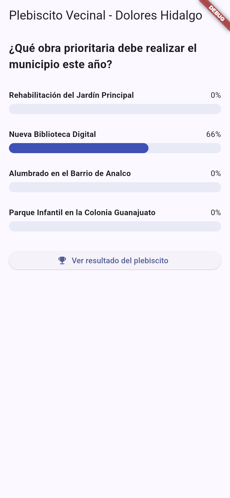
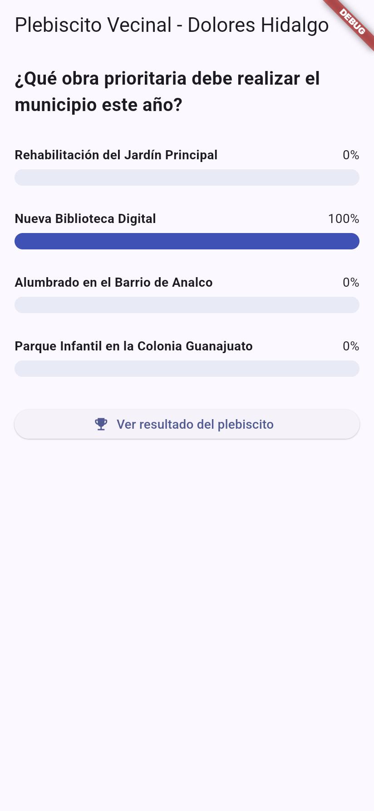
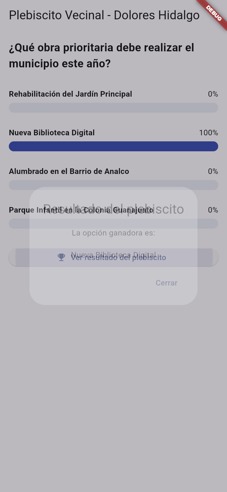
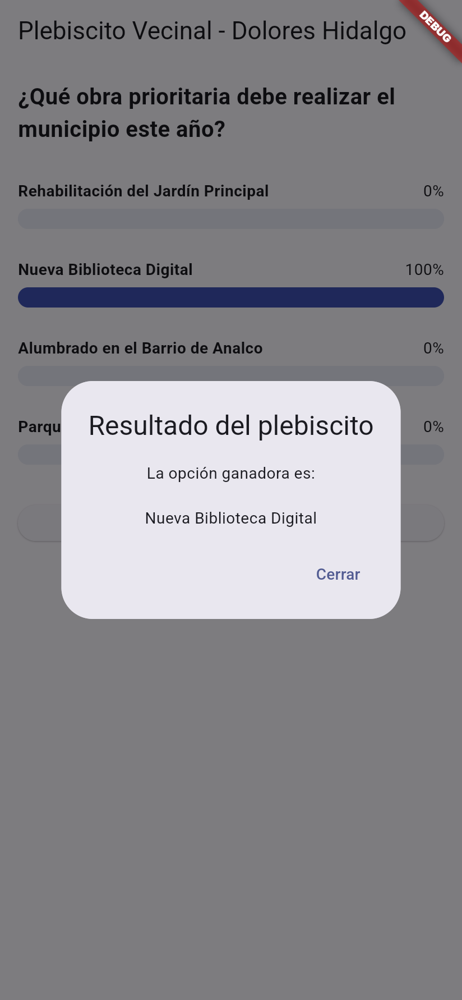

# Vota Dolores Hidalgo (Flutter + TDD)

Plebiscito vecinal: el municipio pregunta qué obra hacer este año, cada vecino vota una sola vez, los resultados se muestran en barras animadas y al final se revela el ganador con una animación elástica. Toda la lógica de votación se construyó con TDD antes de la interfaz.

| | |
|---|---|
| **Actividad** | 5. Ejercicio Plebiscito, Desarrollo de Aplicaciones Móviles (GTID242) |
| **Manual** | *Manual paso a paso con TDD: Vota Dolores Hidalgo* |
| **Alumno** | Christian Jesús Mata Alvarado, No. de control 1225100299 |

## Resultado

| Verificación | Resultado | Evidencia |
|---|---|---|
| `flutter test` (lógica y pantalla) | **16 de 16 pasan** | [`28_todas_las_pruebas.log`](evidencias/logs/28_todas_las_pruebas.log) |
| App real en Linux: un vecino consulta, vota y ve el ganador | **pasa** | [`27_integracion_linux.log`](evidencias/logs/27_integracion_linux.log) |
| `flutter analyze` | sin problemas | [`29_analyze.log`](evidencias/logs/29_analyze.log) |



## Pruebas realizadas

| Archivo | Capa | Pruebas | Qué cubre |
|---|---|---:|---|
| `test/servicio_votacion_test.dart` | Lógica (Dart puro) | 12 | Las 8 rondas del manual (9 pruebas), la integración de la sección 4, el reto del reloj y el caso sin votos |
| `test/votacion_screen_test.dart` | Pantalla | 4 | Barra animada al votar, diálogo del ganador, diálogo sin votos y teléfono chico sin desbordes |
| `integration_test/plebiscito_test.dart` | App completa | 1 | La app real en Linux a tamaño de teléfono; genera las capturas 1 a 6 |

### Bitácora de TDD

Cada paso es un commit. Para ver el orden en que se hizo: `git log --oneline --reverse`. Todas las salidas están en [`evidencias/logs/`](evidencias/logs/).

| Ronda | Regla | Rojo | Verde |
|---|---|---|---|
| 1 | Registrar un voto válido | [01](evidencias/logs/01_ronda1_voto_valido_ROJO.log) | [02](evidencias/logs/02_ronda1_voto_valido_VERDE.log) |
| 2 | Rechazar opciones que no existen | [03](evidencias/logs/03_ronda2_opcion_invalida_ROJO.log) | [04](evidencias/logs/04_ronda2_opcion_invalida_VERDE.log) |
| 3 | Un usuario no vota dos veces | [05](evidencias/logs/05_ronda3_voto_doble_ROJO.log) | [06](evidencias/logs/06_ronda3_voto_doble_VERDE.log) |
| 4 | Porcentajes, también con 0 votos | [07](evidencias/logs/07_ronda4_porcentajes_ROJO.log) y [08](evidencias/logs/08_ronda4_porcentajes_manual.log) | [09](evidencias/logs/09_ronda4_porcentajes_VERDE.log) |
| 5 | Determinar el ganador | [11](evidencias/logs/11_ronda5_ganador_ROJO.log) | [12](evidencias/logs/12_ronda5_ganador_VERDE.log) |
| 6 | Reconocer un empate | no hubo rojo | [13](evidencias/logs/13_ronda6_empate_pasa_sin_cambios.log) |
| 7 | No votar después del cierre | [15](evidencias/logs/15_ronda7_cierre_ROJO.log) | [16](evidencias/logs/16_ronda7_cierre_VERDE.log) |
| 8 | Refactor con guard clauses | no aplica | [17](evidencias/logs/17_ronda8_refactor_VERDE.log) |
| Sección 4 | Plebiscito completo | no hubo rojo | [18](evidencias/logs/18_integracion_plebiscito.log) |
| Reto | Reloj inyectado | [20](evidencias/logs/20_reto_reloj_ROJO.log) | [21](evidencias/logs/21_reto_reloj_VERDE.log) |
| Extra | Sin votos no hay ganador | [22](evidencias/logs/22_extra_sin_votos_sin_ganador_ROJO.log) | [23](evidencias/logs/23_extra_sin_votos_sin_ganador_VERDE.log) |
| Pantalla | Votar, ganador, sin votos, teléfono chico | [24](evidencias/logs/24_pantalla_ROJO.log) | [25](evidencias/logs/25_pantalla_VERDE.log) y [26](evidencias/logs/26_acentos_VERDE.log) |

Los rojos 01, 07, 11, 15 y 20 son errores de compilación, como pasa en TDD cuando el método todavía no existe. Los rojos 03, 05, 22 y 24 son fallos reales al ejecutar:

- **03**: la app truena con `Null check operator used on a null value`, justo lo que el manual advierte del `opcion!`.
- **05**: el segundo voto del mismo usuario regresaba `exitoso`.
- **22**: sin votos, `determinarGanador()` regresaba las 2 opciones como empate (hallazgo 3).
- **24**: con la pantalla del manual, sin votos el diálogo decía "Hay un empate entre:" y nada más.

La ronda 6 y la sección 4 pasan sin escribir código, y el manual dice que así debe ser. Para comprobar que esas pruebas sí sirven se usaron las mutaciones de abajo.



### ¿Las pruebas de verdad detectan errores?

Rompí el código a propósito y corrí las pruebas. Estos cambios no están en el código final.

| Cambio a propósito | Prueba que falla | Log |
|---|---|---|
| Quitar `total == 0 ? 0.0 :` en `obtenerResultados()` | `si no hay ningun voto, todos los porcentajes son 0` (da NaN) | [10](evidencias/logs/10_mutacion_sin_division_cero.log) |
| Cambiar `where(...)` por `[firstWhere(...)]` en `determinarGanador()` | `si hay empate, determinarGanador regresa mas de una opcion` | [14](evidencias/logs/14_mutacion_empate_elige_uno.log) |
| Comentar `if (yaVoto) return ResultadoVoto.usuarioYaVoto;` | La ronda 3 y la integración de la sección 4 | [19](evidencias/logs/19_mutacion_sin_voto_unico.log) |



## Capturas de la app

Las generó el `integration_test` con la app real en Linux, a tamaño de teléfono (412×891). Las capturas 3 y 5 se tomaron a media animación.

| 1. Inicio, sin votos | 2. Resultado sin votos | 3. La barra crece (66% de camino a 100%) |
|---|---|---|
|  |  |  |

| 4. Voto registrado | 5. El ganador aparece (escala y desvanecido) | 6. Ganador |
|---|---|---|
|  |  |  |

## Hallazgos: dónde el código final difiere del manual

Seguí el manual tal cual. Estos cambios salieron de fallos que se pueden reproducir:

1. **Faltaba un import.** El código de la Ronda 4 usa `ResultadoOpcion` en `servicio_votacion.dart`, pero no lo importa, y no compila: `Type 'ResultadoOpcion' not found` ([log 08](evidencias/logs/08_ronda4_porcentajes_manual.log)). Se agregó `import '../modelos/resultado_opcion.dart';`.
2. **El conteo de pruebas no cuadra.** El manual dice que deben pasar 9 pruebas (8 de las rondas + 1 de integración), pero las rondas 4 y 7 traen 2 pruebas cada una: son 9 de las rondas y **10** con la integración. En la Ronda 8 dice "las 7 pruebas anteriores", cuando ya eran 9.
3. **Sin votos, todas las opciones "empataban".** `determinarGanador()` busca el máximo de votos; si nadie votó, el máximo es 0 y todas las opciones lo tienen. Al presionar "Ver resultado" antes de votar, la pantalla anunciaba un empate entre las 4 obras. Se agregó una prueba ([log 22](evidencias/logs/22_extra_sin_votos_sin_ganador_ROJO.log)); ahora regresa una lista vacía y la pantalla dice "Todavía no hay votos." De paso, `reduce` se cambió por `fold`, que no truena con una lista sin opciones.
4. **Textos sin acentos.** La pregunta decía "¿Que obra … este **ano**?". Se corrigieron todos los textos que ve el vecino (año, opción, Jardín, Rehabilitación, votación, cerró). Las descripciones de las pruebas se dejaron como en el manual.
5. **Avisos de `flutter analyze`.** Cuatro concatenaciones con `+` se cambiaron por interpolación, y `primarySwatch` se cambió por `colorSchemeSeed`, porque con Material 3 `primarySwatch` no tiene efecto en los colores de la app.
6. **`opcionInvalida` no tenía mensaje.** La pantalla no avisaba nada en ese caso. Se agregó un mensaje, aunque desde la interfaz no se puede provocar.
7. **Pruebas de pantalla.** El manual no prueba la interfaz. Se agregaron 4 pruebas de widget antes de corregirla, incluida una a media animación que comprueba que la barra todavía no llega a 100%.

## Retos

| Reto | Respuesta |
|---|---|
| Inyectar un reloj | **Hecho con TDD** ([20](evidencias/logs/20_reto_reloj_ROJO.log) → [21](evidencias/logs/21_reto_reloj_VERDE.log)). `ServicioVotacion(votacion, reloj: () => fecha)`, con `DateTime.now` por defecto. La prueba deja fijo que a la hora exacta del cierre todavía se puede votar, y un segundo después ya no. |
| Límite de 500 votos | No se hizo. |
| Votación anónima | El modelo ya es anónimo: `votantes` es un `Set` con los ids de quién votó, pero no guarda por qué opción. Solo se sabe que alguien votó. |
| Confeti con `CustomPainter` | No se hizo. |
| Persistir con `shared_preferences` | No se hizo (ver limitaciones). |

## Checklist del manual

- [x] Cada regla de negocio (voto único, opción válida, fecha de cierre, empates) tiene su propia prueba.
- [x] `ResultadoVoto` se usa para los casos esperados; el servicio no lanza excepciones.
- [x] `obtenerResultados()` no divide entre cero cuando no hay votos (la mutación 10 lo comprueba).
- [x] La pantalla no duplica reglas: no calcula porcentajes ni ganadores ni valida votos.
- [x] Existe una prueba de integración con un intento de voto duplicado.

## Limitaciones

- **No se probó en Android.** La máquina de desarrollo no tiene el SDK de Android ni emulador. Las capturas son de Linux a tamaño de teléfono.
- **Los votos viven solo en memoria.** Cada vez que se abre la app hay un usuario `invitado-<hora>` nuevo y los contadores empiezan en 0, así que un vecino puede volver a votar si cierra y abre la app. Por eso, en las capturas, la opción votada aparece con 100%.
- La fecha de cierre se calcula como "dentro de 7 días" al abrir la app, por lo que en la práctica nunca cierra.

## Cómo ejecutarlo

```bash
flutter pub get
flutter test                 # 16 pruebas, sin emulador
flutter run -d linux         # o `flutter run` con un teléfono conectado

# App completa en Linux; abre una ventana y guarda las capturas:
flutter test integration_test/plebiscito_test.dart -d linux
```

Las imágenes `t1`, `t2` y `t3` se generaron a partir de los logs guardados, sin alterar el texto. Las líneas de más de 118 caracteres se recortan.

## Estructura

```
lib/
  modelos/       opcion_votacion, votacion, resultado_opcion (Dart puro)
  logica/        resultado_voto, servicio_votacion (Dart puro)
  presentation/  votacion_screen (barras y diálogo animados)
  main.dart
test/            servicio_votacion_test, votacion_screen_test
integration_test/  plebiscito_test (app real y capturas)
evidencias/      capturas/ y logs/ de cada ronda
```
